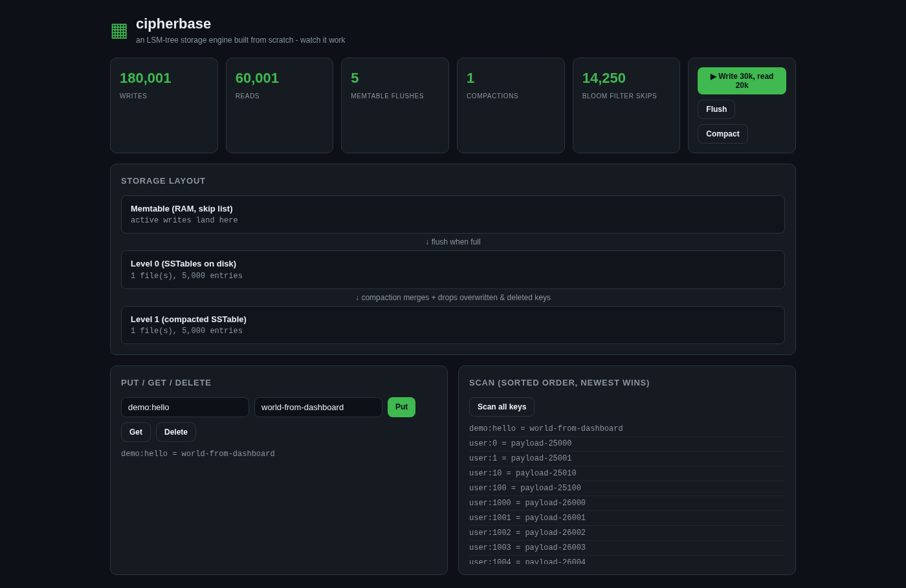

# cipherbase

An LSM-tree storage engine built from scratch in Go - the same architecture that
powers RocksDB, Cassandra, ScyllaDB and LevelDB - with a live dashboard where you
can watch writes flow from memtable to L0 to L1 in real time.

**Demo video:** https://drive.google.com/file/d/1an5nX839ZxjNf0lVkXdwcAF4fx8_bZMt/view (also in `demo/cipherbase-demo.mp4`)
**Report (PDF):** https://drive.google.com/file/d/10deakR-959ss1kWhohfxFlohRF9kacvl/view (also in `docs/report/REPORT.pdf`)



## What it does

- `Put / Get / Delete / Scan` over an ordered key space
- Writes go to an in-memory **skip-list memtable**; every write is first appended
  to a **write-ahead log** (CRC32 per record, torn-tail tolerant) so a crash
  loses nothing - replay rebuilds state on startup
- Memtable full (1 MiB) -> flushed to an immutable **SSTable** (Level 0)
- 4+ L0 tables -> **compaction** merges them into Level 1, dropping shadowed
  keys and tombstones
- **Bloom filter** per SSTable (measured 0.97% false-positive rate at 1% target)
  skips files that cannot contain the key
- **Sparse index** (every 16th key) makes point lookups and range scans seek
  instead of scan: a bounded scan costs O(limit), not O(dataset)
- REST API + embedded live dashboard (Go 1.22+ `http.ServeMux`, `go:embed`)

## Measured performance

Single goroutine, sequential calls, in-process engine API (no HTTP), fixed seed,
200k keys (16B key, 100B value), linux/amd64, Go 1.26.6. Reproduce with
`go run ./cmd/bench` (writes `benchmarks.json`).

| Operation | Throughput | Latency |
|---|---|---|
| Write | **153,735 writes/s** | 6.5 µs/op |
| Point read (hit) | **28,110 reads/s** | 35.6 µs/op |
| Range scan (100 keys) | - | **0.43 ms/op** |

The range-scan number is the interesting one: the first implementation merged
every SSTable in full per scan (113 ms/scan). Seeking per level with the sparse
index and k-way merging with early termination made it **~260x faster**. That
bug - found by benchmarking, fixed, and re-measured - is documented in the
report, because finding it is the point of building this from scratch.

## Architecture

```
write -> WAL (CRC) -> memtable (skip list)
                          | 1 MiB
                          v
                     L0 SSTables (immutable, bloom + sparse index)
                          | >= 4 files
                          v
              L1 SSTable (compacted: shadowed keys + tombstones dropped)

read: memtable -> L0 newest-first (bloom-gated) -> L1
scan: k-way merge, newest source wins, tombstones suppress
```

## Run it

```bash
go run ./cmd/server            # dashboard on http://localhost:8090
go test -race ./cb/            # 9 tests: WAL crash replay, bloom FP rate,
                               # compaction shadowing, scan ordering, ...
go run ./cmd/bench             # reproduces the numbers above
docker build -t cipherbase . && docker run -p 8090:8090 cipherbase
```

## Honest notes

- Two levels (L0, L1), not a full leveled cascade - the compaction policy is
  the teachable core, tiering beyond L1 is repetition
- Read latency is dominated by per-read file open; a block cache / FD cache is
  the next lever (documented in the report)
- Benchmarks are sequential by design: the sandbox throttles concurrent loopback
  work, and a single-threaded number is the honest, reproducible one
